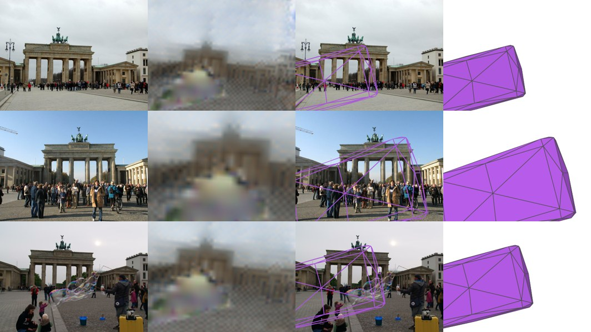

# DBW gate v1: November 22–23, 2026

[Issue #30](https://github.com/carldjapardi/Splatastrophe/issues/30) · result: **failed**. No useful parts; see the analysis below.

## Settings

- **Data:** IMC-PT 2020 `brandenburg_gate` dense COLMAP model: 1,363 registered photos, 100,040 sparse points, PINHOLE cameras.
- **Views:** NeRF-W `brandenburg.tsv` train split (859 registered). The prep kept 640 views: landscape only, camera within 8 units, and the gate center in front of the camera and inside the crop. Images were resized and center-cropped to 384×288.
- **Normalization:** up = mean camera up. The SVD major horizontal axis of the core points becomes x. The 2nd–98th height percentiles map to 1.4 units with the plaza at y = −0.9. Core extent in DBW units: x [−0.62, 0.60], y [−0.90, 0.50], z [−0.45, 0.23]. Median camera distance is 3.24. The reprojection overlays lined up with the gate.
- **Model:** 10 blocks, `T_range [1.5, 0.6, 0.5]`, identity world transform. Loss weights match the upstream campanile config: rgb 1, perceptual 0.1, parsimony 0.01, tv 0.1, overlap 1. Coarse phase 125 epochs, 160 epochs total, LR drop at 150, batch 4. Full config in `brandenburg.yml`.
- **Code:** upstream DBW main as cloned Nov 22, 2026 (`fb08bd1`, the latest upstream commit), plus `phototourism.py` from this folder.
- **Compute:** Yushan's Thunder RTX A6000 at $0.35/hr. About 53 s/epoch, 2 h 10 min wall time (00:48–02:58 UTC Nov 23), about $0.80. The instance was deleted after the results were copied.

## Result

Parsimony pruned 9 of the 10 blocks. Final opacities:

| block | 0 | 1 | 2 | 3 | 4 | 5 | 6 | 7 | 8 | 9 |
| --- | --- | --- | --- | --- | --- | --- | --- | --- | --- | --- |
| alpha | 0.03 | 0 | 0 | 0 | 0 | 0.03 | **0.96** | 0 | 0.02 | 0 |

Columns: input, DBW render, surviving blocks overlaid on the input, blocks without background.

- The surviving block is one large box at crowd height in front of the left half of the gate. It doesn't match the columns, attic or quadriga.
- The gate in the renders comes from the textured background icosphere.
- `loss_rgb` plateaued at about 0.05 by epoch 27 and ended at 0.049.

This fit can't be used for splat grouping, and splat-to-block assignment was not attempted.

## Likely causes

1. **Appearance variation:** PhotoTourism photos vary in lighting, season and exposure, and DBW has one texture per block with no per-image appearance model. A blurry background explains the average image about as well as blocks do.
2. **Crowds:** people cover the lower third of most views. The surviving block sits exactly where the crowd is.
3. **Small target:** with the gate filling only part of each frame, the ground plane and background dome account for most pixels.
4. **Early pruning:** parsimony removed most blocks during the coarse phase, before any of them moved onto the gate.

## Proposed v2 (not run)

- Gate foreground masks (#12): use them as a DBW alpha target, or zero out people and sky in the RGB loss.
- A tighter crop around the gate, and a lower `parsimony_weight` (for example 0.001) for the coarse phase.
- Initialize blocks across the gate footprint (x ∈ [−0.6, 0.6], y ∈ [−0.9, 0.5]) instead of the default random spread.
- Possibly train only on photos with consistent lighting and few people.

If v2 still fails, per plan section 7, grouping stays manual (section 6 baseline) and this record is the failure analysis.

## Artifacts (outside Git)

`Splatastrophe/outputs/dbw/` on Yushan's Mac: `runs/phototourism/gate_v1/` (`model.pkl` 83 MB, metrics, quali_eval, evolution renders), `cameras.npz`, `points.npy`, and the training log.
