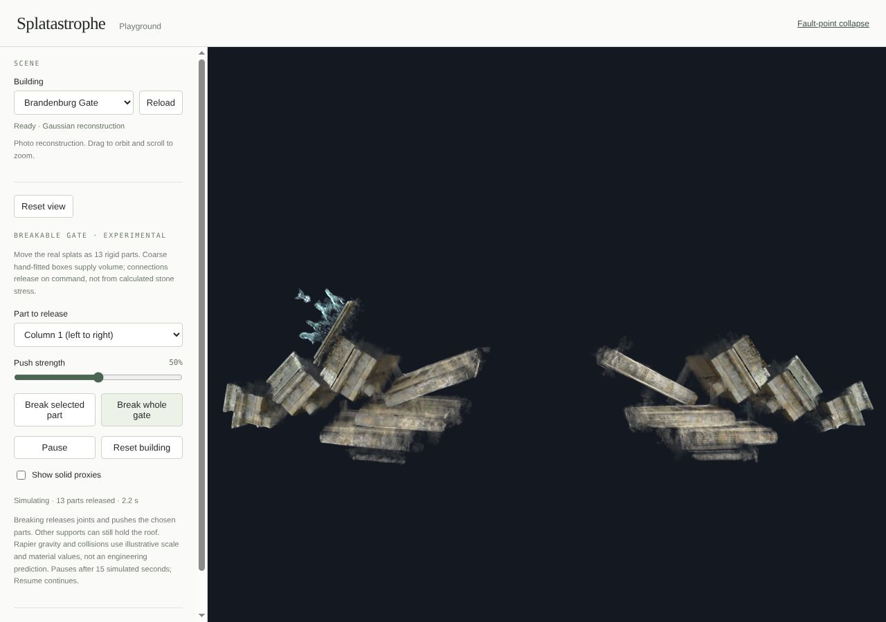

# Brandenburg Gate: browser rigid-part prototype

Issue #38 · base `yushan/dbw-gate` · branch `codex/task2-part-decomposition`.

Yushan changed the immediate goal from the five-phase offline study to integrating building-breaking physics in the existing website, and explicitly suspended Slack coordination for this work. This is a coarse interactive baseline, **not completion of the original Task 2 research acceptance checks**. Isaac's `web/src/impact/` module and the `/faults/` demo are unchanged. No GPU jobs, cloud instances, deployment, or merge were started.

## What runs

Select Brandenburg Gate and enable breaking physics. Choose a part and push strength, break that part, or break the whole gate. Pause/resume and reset are separate from camera reset. The whole-gate action widens the camera to include debris. Other landmarks retain their static viewer.

Six column groups, six roof sections and one sculpture group follow 13 Rapier rigid bodies. Closed cuboids give mass and inertia; face-touching proxies receive fixed joints, and columns receive ground anchors. Breaking explicitly removes incident joints and applies a mass-scaled impulse; it does **not** infer material failure from stress. Whole-gate breaking removes every joint and pushes each part. Merely removing joints may leave a stable stack; a single released column can remain wedged under a roof held by other columns.

All 1,893,636 original Gaussians remain present, in the same SOG texel-index order. Membership uses rest positions and never changes as parts move. The work-buffer shader rotates Gaussian centers and orientations, not just their bounding boxes. CPU sorting centers receive the identical rigid transforms. Updates wait for a completed sort and rendered frame before submitting another center version, avoiding an asynchronous-sort backlog that otherwise freezes the visible pose until pause. Multisampling is disabled for landmark splats. All other renderer controls and the source SOG are unchanged.

## Geometry and units

[`gate-browser-parts.json`](gate-browser-parts.json) is the shared source for the browser and export. The boxes and membership cuts were hand-fitted against front/side projections of the actual decoded centers. They are a reference baseline, not EMS, Marching-Primitives, DBW or independently annotated ground truth. Paired front/back columns are represented by one filled-depth proxy; thin facade splats do not establish real interior structure. No geometric IoU score is claimed.

Source SOG SHA-256: `79a08ca9a39e50000aa67fdd444f03ba4dd08319accec0196a1845596f769625`.

Source → viewer is `diag(1,-1,-1)`, exactly the catalog's 180° X rotation. The viewer is Z-up. Ground is `z=-0.09`. The illustrative physics scale is 160 meters per viewer unit; it is not surveyed. Columns have half-width 0.0075, depth 0.060, and height 0.076 viewer units (2.4 × 9.6 × 12.16 illustrative meters). The roof occupies `z=[-0.014,0.029]`. Sculpture bounds and all six X positions are in the JSON.

Rapier settings: Z gravity −9.81 m/s², 1/120 s fixed steps, 12 solver iterations, 2200 kg/m³ density, friction 0.7, zero restitution, CCD enabled. Contact tolerance is 1e-5 viewer units with positive face overlap; edges alone are not bonded. No randomness or seed is used. Browser wall-time contributions are capped at 0.05 s per update, and simulation pauses after 15 additional simulated seconds. Slow machines therefore run in slow motion rather than taking unstable steps.

## Reproduce

```sh
cd web
npm ci
npm run check
npm run dev
```

From the repository root, using Python 3.12.3 with NumPy 2.5.5 and Pillow 13.0.0:

```sh
python experiments/dbw/export_gate_browser_parts.py --out outputs/task2-browser
```

The exporter supports the checked-in SOG v3 and writes `part_id.npy` (int16, one entry per original splat), decoded centers/opacities/scales, proxy primitives, 13 face-contact pairs/areas, six ground-anchor IDs and provenance metadata. It performs no opacity filtering or sorting. The final export took 5.14 seconds on Ubuntu 24.04, four AMD EPYC virtual CPUs, 16 GB RAM, with the browser also running. Counts by part ID 0–12 were: 47497, 93727, 106819, 75904, 73303, 57661, 130233, 209470, 311187, 303053, 229287, 89538, 165957. No splats fell outside the assignment bounds. The sculpture's X bounds prevent the long roof cornice from moving with the sculpture. Generated data stays in ignored `outputs/`.

## Verification and limitations

- `npm run check`: 44 tests passed, TypeScript passed, Vite production build passed. PlayCanvas 2.24.1 and Rapier 0.21.0 use the repository lockfile. Tests cover actual-gate support loss, frame-independent physics, reset/replay, invalid input, initialization retry, membership boundaries, and viewer/source sorting transforms.
- At default 50% whole-gate push, at least three roof sections drop more than 0.02 viewer units after five simulated seconds. Exact reset restores all initial proxy poses and zero released parts.
- Chromium browser checks at 1280 × 900 confirmed activation, continuous visible splat motion, proxy overlays, building/view reset and switching to Trevi and back, with no console errors. A 390 × 844 emulated-mobile view confirmed the reset building and usable stacked controls. The software-rendered cloud browser is slow with all 1.89 million splats; no laptop FPS or mobile-performance claim is made. Node was 24.22.3. The demonstration video is accelerated 6×; its simulation-time readout is not wall time.
- Large/low-opacity source Gaussians can stretch the visible silhouette of a separated group. Sparse rear coverage and crude boxes make exposed surfaces incomplete. The system does not generate new fracture surfaces or subdivide parts on impact.
- The analytic topple benchmark, synthetic IoU harness, EMS/Marching-Primitives comparison, DBW export/chamfer patch, and independent gate reference comparison remain unfinished. This prototype must not be used as evidence that those original acceptance checks passed.
- Production is unchanged until the branch is reviewed, merged through the intended base, and deployed by the site's owners.


