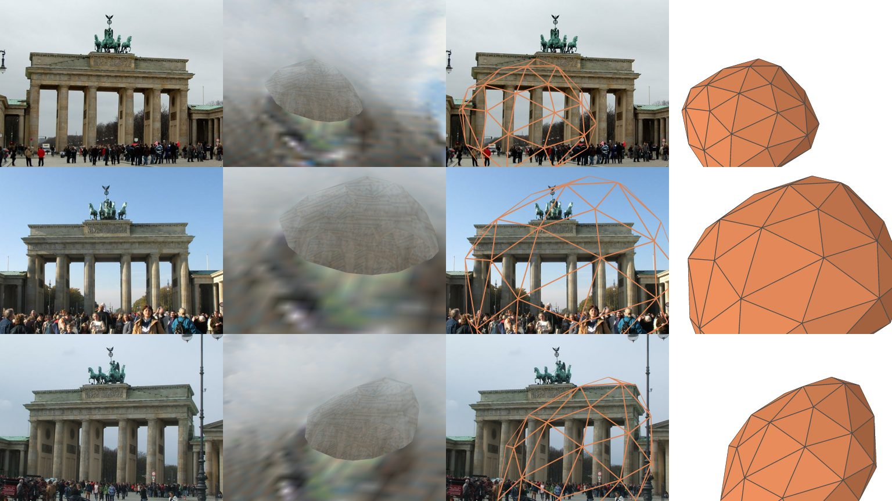
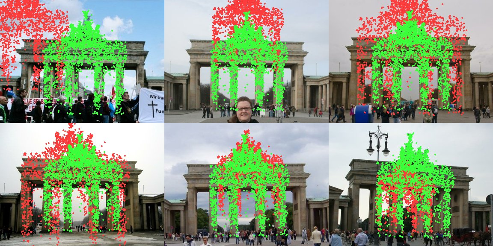
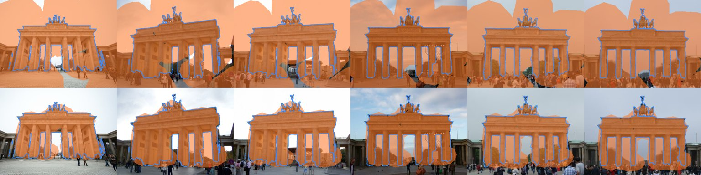

# DBW gate v2: November 24, 2026

[Issue #30](https://github.com/carldjapardi/Splatastrophe/issues/30) · result: **failed**. Like v1, the fit gives no usable parts. Follows [v1](2026-11-23-gate-v1.md).

## Settings

- **Data:** the 268 gate-centred views prepared on November 23 ([README](README.md#prepared-dataset-november-23-2026)). They are cropped to 384×288 and use tri-state gate masks: gate, background, and an ignored crowd band.
- **Model:** 12 blocks initialized uniformly over the gate (`T_center [0, -0.2, -0.1]`, `T_range [0.9, 0.7, 0.3]`, `T_ground_y -0.9`). The loss weights are:
  - rgb 1, perceptual 0.1, tv 0.1, overlap 1, as in v1
  - parsimony 0.002, down from 0.01
  - the new silhouette loss at weight 1, with `mask_bkg_weight` 0.5

  Coarse phase 300 epochs, texture decimation 150, LR drop 360, 380 epochs in all. Batch 4, about 25.5k iterations. Full config in `brandenburg_v2.yml`.
- **Code:** upstream DBW `fb08bd1` + `dbw_masks.patch` + `phototourism.py`, both from this folder (commit cf258dc).
- **Compute:** Thunder RTX A6000 at $0.35/hr.
  - About 13 min of setup: miniforge, conda env, patch.
  - Training: 02:43–06:08 UTC, about 32 s/epoch. GPU utilization was about 30%, so the 6 vCPUs were probably the bottleneck.
  - Credit went from $2.07 to $0.76, so $1.31 in all. That includes a first instance I deleted a few minutes after creating it, because it had no SSH key.
  - The instance was deleted right after the results were copied.
- As in v1, the final qualitative eval crashed with the MAGMA `misaligned address` error while writing a trajectory video. This was after `model.pkl` and the quali_eval images were saved.

## Result

Most blocks faded rather than being pruned outright. Only block 11 passes DBW's 0.5 opacity threshold, so it is the only one drawn in the eval renders. Final opacities:

| block | 0 | 1 | 2 | 3 | 4 | 5 | 6 | 7 | 8 | 9 | 10 | 11 |
| --- | --- | --- | --- | --- | --- | --- | --- | --- | --- | --- | --- | --- |
| alpha | 0.05 | 0.12 | 0.04 | 0.05 | 0.06 | 0 | 0 | 0.11 | 0.02 | 0.04 | 0.35 | **0.56** |

Most of the opacity was lost early. At epoch 5 every block was still between 0.28 and 0.47, and by epoch 300 the opacities had reached their final values.

Columns, left to right:
1. input
2. DBW render
3. visible block overlaid by the eval script
4. the block alone

**Shape:** the visible block is a rounded blob covering the middle of the gate. Its shape matches none of the columns, the attic or the quadriga, and the rest of the gate is a blurry background.

**Placement mismatch:** the eval overlay (column 3) puts the blob in a different place than the render (column 2) and moves it between views. It is not yet known whether the overlay path uses different camera settings or the block really sits at the wrong depth.

**Loss curve:**

| | start | coarse-phase minimum | after epoch 300 | final |
| --- | --- | --- | --- | --- |
| mask loss | 0.33 | 0.22 (epoch 150) | jumped to 0.30 | 0.29 |
| rgb loss | 0.084 | | | 0.065, flat after epoch 5 |

The coarse phase allows partly transparent blocks. The jump in mask loss when it ended suggests that the faint blocks were what covered the mask, and the sharper blocks of the final phase could not cover it.

This fit can't be used for splat grouping, and splat-to-block assignment was not attempted.

## What this adds to v1

- Masks, the tighter crop, weaker parsimony and initializing blocks over the gate did not produce parts. The same outcome as v1, one dominant block, came back with different settings. The camera check below shows why.
- Pruning wasn't the main cause. With parsimony at 0.002, blocks still faded out during the coarse phase instead of moving to the columns.
- The silhouette loss was met with faint blobs rather than block shapes.
- The rgb loss flattened by epoch 5 in both runs.

The camera check below explains all of these better than v1's explanations do.

## Camera check (November 24): both runs used the wrong intrinsics

DBW sets the camera intrinsics **once**, from the first view of the first batch. This happens in `predict()` in `src/model/dbw.py` (`if 'K' in inp and self.renderer.cameras.K is None: ... K=inp['K'][0:1]`), and that K is reused for every later view. That is fine for DTU and BlendedMVS, where one camera takes every photo. PhotoTourism photos come from many cameras and zoom settings, and our gate-centred crops move the principal point as well:

| | focal length (px, 384×288 crops) | principal point x |
| --- | --- | --- |
| v1, 640 views | 190 to 1514, median 421 | centred (center crop) |
| v2, 268 views | 215 to 1156, median 535 | 3 to 324 (gate-centred crop) |

`check_cameras.py` projects the sparse gate points through PyTorch3D's `PerspectiveCameras` using DBW's own `pytorch3d_KRT_from_proj`, once with each view's K and once with one shared K, as in training. It then measures the share of points that land inside the gate mask:

| intrinsics | median points in mask | views under 50% |
| --- | --- | --- |
| each view's own K | 0.93 | 0 of 268 |
| one shared K (training) | 0.60 | 104 of 268 |

Green dots use each view's own K; red dots use the shared K. Each tile shows a different view.

So the loader and pose normalization are correct, but in training most views showed the gate at the wrong scale and position. No single block layout could match all views, which explains:
- the blob, which is a compromise across views
- the rgb loss that flattened early
- the eval overlay landing in a different place from the render

The likely causes listed for v1 (lighting, crowds, small target) are still possible, but neither run actually tested them.

## Per-view K fix (November 24)

`dbw_per_view_K.patch`, applied after `dbw_masks.patch`, renders every view with its own K. This covers training, evaluation, the eval images and the edge overlays.
- PyTorch3D refuses a batch of K on a camera object built for one view, so the patch builds a camera batch from each call's K and passes it to the rasterizer and shader.
- PyTorch3D 0.7.1, the GPU env, reads the per-call K the same way as the local 0.7.8. Checked in its source.

Two CPU checks, run with `outputs/dbw/venv-dbw` on Yushan's Mac:

1. **`check_per_view_K.py`** renders small cubes at 300 sparse gate points through DBW's renderer. It uses a batch of 8 views spanning the focal-length range, with the camera default set to the first view's K as upstream does. It then counts how many of each view's correctly projected points land on rendered cubes.
   - Shared K: 0.82 for the first view and 0.01 to 0.16 for the other seven.
   - Per-view K: 0.82 to 0.92 for all eight. Tiny cubes don't render fully opaque, so not 1.0.
   - Edge overlays with per-view K: 0.98 to 1.0.
2. **`check_mask_fit.py`**, a mask-only fit: 24 views spread across the focal-length range, 150 steps at batch 2, the v2 config and initialization, the same seed for both. Only the mask, parsimony and overlap losses are on. IoU between block coverage and the gate mask is scored with each view's true K, ignoring the crowd band:

| | start | after 150 steps | views above 0.5 |
| --- | --- | --- | --- |
| upstream (one shared K) | 0.33 | 0.35 (mask loss 0.39 → 0.31) | 0 of 24 |
| per-view K | 0.33 | **0.70** (mask loss 0.39 → 0.08) | 24 of 24 |

Every one of the 24 views improved.

In the figure, orange is block coverage and the blue line is the gate mask.

**Limits of the check:**
- The fixed fit still fills the openings between columns. It shows that blocks land on the gate consistently across views, not that they split into separate parts.
- This fit is 150 steps with only silhouette losses. The full run adds rgb and perceptual losses and ends with sharp blocks after the coarse phase. Whether parts come out still needs a GPU run.

## Status

Grouping stays manual (plan section 6 baseline) until a corrected GPU run succeeds. The next run is v2 with `dbw_per_view_K.patch` added. Nothing else changes. Thunder credit is $0.76 and a full run cost $1.31, so it needs a top-up or another GPU source.

## Artifacts (outside Git)

`Splatastrophe/outputs/dbw/v2/runs/gate_v2/` on Yushan's Mac:
- `model.pkl` (97 MB)
- metrics TSVs
- `quali_eval/` with mesh and textures
- `reconstructions/` evolution videos
- `dbw_v2.log` (trainer output) and `v2_run.log` (setup log)
