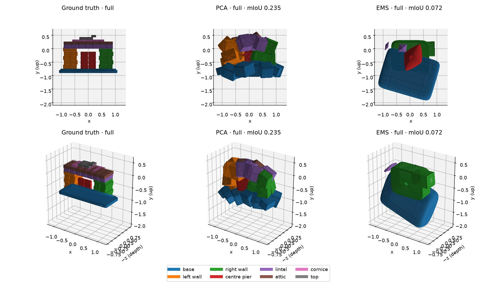
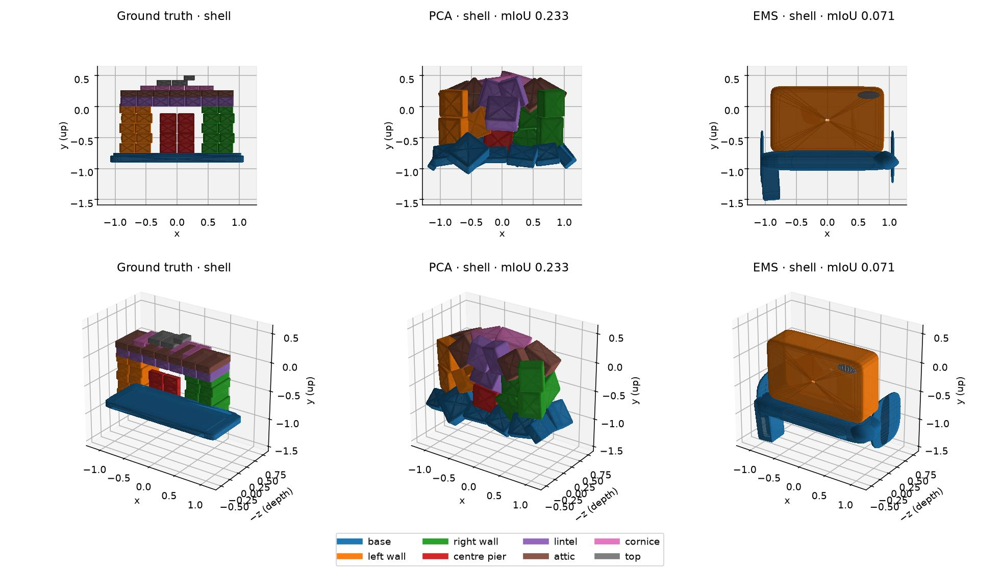
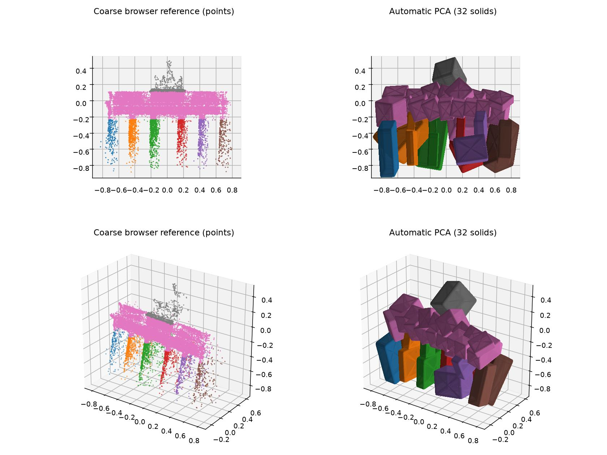

# Route C: automatic parts from points

November 24, 2026 (America/Los_Angeles) · issue #38 · branch `codex/task2-part-decomposition` · parent browser prototype `214fd56`.

**Conclusion:** automatic fitting works as a reproducible CPU pipeline, but neither tested configuration recovers good mechanical parts on the synthetic control. K-means/PCA wins semantic part IoU, so it was applied to the gate. The automatic gate fit resembles the facade but is not validated as physical decomposition. The hand-fitted browser mode is unchanged; no automatic fit was substituted into it.

Yushan approved comparing clustering/PCA against hierarchical EMS, then applying the better method to the gate. Slack coordination remains suspended by his instruction. This work touches only `experiments/dbw/`. It does not complete the DBW GPU preparation or analytic topple benchmark from the original five-phase spec.

## Reproduce

Run from a fresh checkout with Python 3.12:

```sh
test -x .venv/bin/python || uv venv --python 3.12 .venv
uv pip install --python .venv/bin/python -r experiments/dbw/route-c-requirements.txt
.venv/bin/python experiments/dbw/prepare_ems.py
OPENBLAS_NUM_THREADS=1 OMP_NUM_THREADS=1 .venv/bin/python -m pytest experiments/dbw/test_part_eval.py experiments/dbw/test_fit_primitives_3d.py -q
.venv/bin/python experiments/dbw/part_eval.py --self-test --output outputs/route-c-comparison/self-test.json
OPENBLAS_NUM_THREADS=1 OMP_NUM_THREADS=1 .venv/bin/python experiments/dbw/run_route_c.py --out outputs/route-c-comparison
OPENBLAS_NUM_THREADS=1 OMP_NUM_THREADS=1 .venv/bin/python experiments/dbw/apply_route_c_gate.py
```

The upstream [EMS Python code](https://github.com/bmlklwx/EMS-superquadric_fitting/tree/5a213d46e8b013b5a153f5aa914b0925ee517af7/Python) includes both single-superquadric recovery and a hierarchical example. It is **not MATLAB-only**. `prepare_ems.py` pins commit `5a213d46e8b013b5a153f5aa914b0925ee517af7` under ignored `external/`. The committed compatibility patch replaces removed `np.int` with `int` and defers optional Mayavi imports until visualization is requested; fitting equations are unchanged. Attribution and the MIT license are in `EMS-NOTICE.txt`.

Marching-Primitives and CoACD are not part of this approved two-method comparison. The official [Marching-Primitives repository](https://github.com/ChirikjianLab/Marching-Primitives) documents a MATLAB implementation requiring the Image Processing Toolbox, with Python described as planned. No MATLAB port or shell SDF reconstruction is claimed here.

## Fixed settings and evaluation

- Training: 12,000 candidate surface points, seed 38, from the existing `faults_geometry.surface_points`. Its block-area weighting and uniform face-axis choice are retained unchanged; samples are not perfectly area-uniform across each box's faces. Full retains all 12,000. Shell retains 5,451 visible points after analytic segment/box occlusion from 21 front cameras: seven azimuths from −60° to +60°, elevations 0°, 15°, 30°, distance four DBW units from `[0,-0.2,0]`. Own-box occlusion is included, so rear faces do not become visible by ignoring the generating box.
- Held-out assignment evaluation: independently sampled 12,000 candidates, seed 39; full retains 12,000 and shell 5,510. The existing generator includes interior/interpenetrating faces. Its generating-block labels are never changed. No labels, authored boxes, camera IDs or reference groups enter either fitter.
- Both methods normalize coordinates by their mean and maximum axis span, then transform outputs back. Primitive budget is 32, not the known 52-box count. These are one fixed configuration each, not a hyperparameter sweep or a claim of global algorithm superiority.
- PCA: k-means++, 32 clusters, seed 38, five initializations, at most 100 Lloyd iterations. Each cluster gets its PCA orientation and min/max local bounds. A half-size floor of 0.0025 times input maximum span is an explicit thickness prior for degenerate clusters. Output box approximation uses `eps=[0.1,0.1]`.
- EMS: official recovery with `OutlierRatio=.9`, `MaxIterationEM=20`, `ToleranceEM=.001`, `RelativeToleranceEM=.1`, `MaxOptiIterations=3`, `Sigma=0` (automatic), `MaxiSwitch=2`, `AdaptiveUpperBound=False`, `Rescale=True`. The official hierarchical pattern retains each fitted primitive and DBSCAN-clusters points whose posterior is below .1 when posterior mass is below .8 times component size. DBSCAN radius is .04 normalized units, minimum samples 12, minimum fit component 60, maximum depth five, maximum primitives 32. Rank-deficient components and numerical failures are reported, never silently replaced by hand-fitted boxes. All four measured runs had zero failed fitting components.
- Each fit subprocess has a hard 840-second deadline. BLAS, OpenMP and Numba threads are capped at one. Fit wall times below include subprocess startup. The final full EMS run includes JIT compilation after the compatibility patch was reapplied; the following shell run reuses its cache.
- Ground-truth voxel spacing is `1.4/128 = 0.0109375` DBW units. The domain includes **all** predicted OBB extents, including solids below the ground or outside the building. Processing uses 65,536-voxel chunks and refuses domains above 20 million voxels rather than silently clipping them.
- Each truth voxel keeps the first containing authored block, its part and fault. Each predicted primitive maps to the majority true part among its occupied truth voxels. Part IoU uses the **independent union** of all primitives mapped to that part, so primitive ordering cannot hide overlaps. Union-volume IoU penalizes all predicted geometry. Point assignment uses minimum implicit F, evaluated in log space to preserve ordering far outside small primitives. Ties use input order. The local z axis carries exponent e1; the local x/y plane carries e2, matching the official EMS equation.

## Synthetic results

| Method | Input | Parts | Mean part IoU | Parts IoU > .5 | Volume IoU | Point assignment accuracy | Fit wall seconds |
|---|---|---:|---:|---:|---:|---:|---:|
| K-means/PCA boxes | Full | 32 | 0.2349 | 0/8 | 0.5038 | 0.6634 | 0.756 |
| Hierarchical EMS | Full | 10 | 0.0717 | 0/8 | 0.2977 | 0.3978 | 9.625 |
| K-means/PCA boxes | Shell | 32 | 0.2327 | 0/8 | 0.4317 | 0.7069 | 0.715 |
| Hierarchical EMS | Shell | 9 | 0.0715 | 0/8 | 0.5232 | 0.4764 | 1.604 |

The selection rule was fixed before applying either method to the gate: average full/shell mean semantic voxel IoU. PCA scores **0.2338** versus EMS **0.0716**. EMS obtains the better shell union-volume IoU but largely merges structural regions; fitting occupied volume is not equivalent to recovering parts. PCA makes tilted, overlapping chunks and misses small parts. Neither configuration is an acceptable automatic replacement for the hand-fitted mechanical baseline.

Figures show mapped-part colors, front and three-quarter views, with identical bounds across methods including hallucinated geometry. Ground-truth rendering uses the same rounded-box visualization convention; evaluation truth is the sharp authored boxes.





## Self-test and the overlap caveat

The 52 true boxes, exported with eps=.1, give mean part IoU **0.976673**, volume IoU **0.988206**, and assignment accuracy **0.963583**; all eight parts exceed .5 IoU. These are near-unity controls, not exact ones:

1. Rounded superquadrics cut corners off exact boxes.
2. The authored lintel intersects earlier wall/pier boxes. With exclusive true voxel labels, even the exact sharp lintel union has IoU **0.885361**, not one: 11,997 of its voxels already belong to earlier parts. Rounded lintel IoU is **0.880648**. Reporting one would require changing the specified geometry or label convention.
3. Of 437 point-assignment errors, 423 occur inside a different true part. The surface generator labels by the generating block, whereas minimum F chooses a containing solid; those policies disagree at interpenetrating surfaces.

The self-test reports exact-box and rounded-box per-part vectors. It requires mean/volume/assignment scores ≥.95 and each rounded per-part IoU within .035 of its exact-box-overlap baseline; the maximum measured difference is .020129. Ground truth was not relabeled to pass. Tests also cover anisotropic exponents, rotated solids, outside-volume penalties, malformed input, shell occlusion, empty fits, permutation-invariant geometry scores, deterministic fitting, thickness assumptions and known ellipsoid recovery by the actual EMS library. **21 tests pass.**

## Automatic gate application

The selected PCA method was fitted to Gaussian centers only. No column coordinates, roof cuts or manual part IDs were supplied to fitting. Opacity threshold .02 retained **1,125,596** of **1,893,636** splats; the fitter deterministically sampled 12,000 of those with seed 38, keeping the same 32-part budget/settings used in the synthetic comparison. Fit subprocess wall time was **0.767 s**; decoding, fitting, assignment and metadata generation together took **4.118 s** before plotting.

The SOG v3 decoder preserves original texel order. Source SHA-256 is `79a08ca9a39e50000aa67fdd444f03ba4dd08319accec0196a1845596f769625`. Source → viewer is `diag(1,-1,-1)`. Viewer → DBW maps `(x,y,z-up)` to `(x,z,-y)`, centers horizontal/depth coordinates from filtered data, scales filtered height to 1.4 and puts its minimum y at −.9. The exact invertible 4×4 transform is exported. These are normalized units, not calibrated meters.

`outputs/route-c-gate/part_id.npy` contains int16 primitive IDs for **every original SOG index**, including low-opacity splats. Opacity filtering affects fitting only. IDs are run-specific; source splat order is unchanged. Assignment is by minimum implicit F even outside a solid; **97.26%** of all splats are inside their assigned solid, which does not prove those solids have correct volume. Both DBW-frame and viewer-frame primitives are exported. A 2,000-index recomputation matched the exported assignments exactly, and the frame round-trip preserved implicit values to 1e-8 absolute tolerance.

Only after fitting and assignment, the previous hand-fitted browser grouping was consulted as a **coarse, non-independent reference**. Its six roof sections were merged into one attic/roof class, giving six columns, roof and quadriga. Even source indices above the opacity threshold establish majority mappings; odd indices score agreement. Results: **0.7111 macro point IoU**, **0.9272 point agreement**. Roof points dominate this reference; the quadriga IoU is only **0.2257**. This is not gate volume IoU, a manual-annotation validation, or a physics benchmark.



## Environment, artifacts and next decision

Measured on the existing Ubuntu 24.04 machine: four AMD EPYC virtual CPUs, 16 GB RAM, Linux 6.1.158+, Python 3.12.3. Packages: NumPy 2.2.6, SciPy 1.15.3, Numba 0.61.2, llvmlite 0.44.0, scikit-learn 1.6.1, threadpoolctl 3.6.0, plyfile 1.1.3, Matplotlib 3.11.2, Pillow 13.0.0, pytest 8.4.2. Synthetic comparison including evaluation and figures took **44.685 s**. These are CPU timings, but **not laptop timings**: Beepbeep disconnected at 22:00:28 PST before the laptop run. No additional cloud machine, GPU job or paid service was started.

Generated point sets, fits, scores, provenance and figures stay in ignored `outputs/route-c-comparison/` and `outputs/route-c-gate/`. Only this record, code, dependency pins, license notice and small referenced figures are committed. The supplementary archive contains the score/self-test JSON, all synthetic fits and the full-order gate membership/primitives/metadata.

The next algorithmic step is to generate connected, surface-normal-consistent candidate regions before fitting, then run EMS within candidates rather than letting its first primitive cover the whole facade. That should be tested against this same harness, not assumed to fix it. Automatic browser integration, a physically meaningful contact graph for these rotated solids, independent gate annotation, DBW routes A/B and analytic toppling validation remain open.
