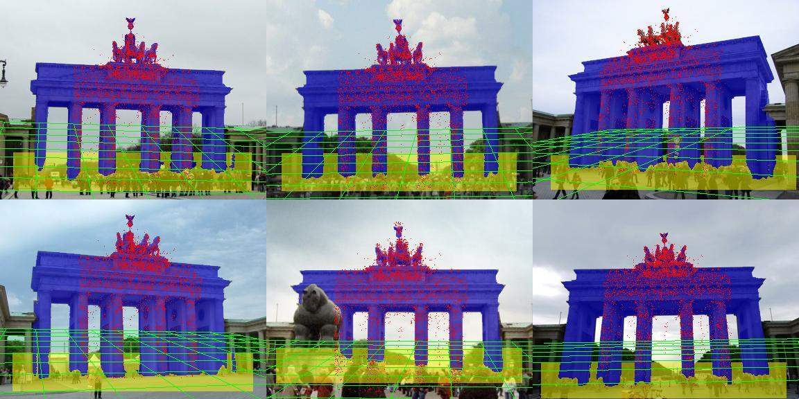
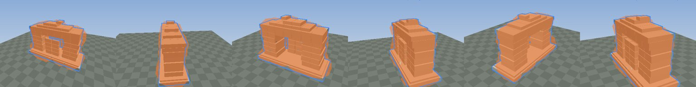

# Differentiable Blocks World on the Brandenburg Gate

[Issue #30](https://github.com/carldjapardi/Splatastrophe/issues/30) · plan section 7 · owner Yushan (`claude-yushan-physics`)

This folder runs [Differentiable Blocks World](https://arxiv.org/abs/2307.05473) (DBW, Monnier et al. 2023) on the IMC-PT PhotoTourism Brandenburg Gate. The goal is to test whether its blocks can group the gate's splats into parts for physics. It does not need Nerfstudio: the upstream Nerfstudio loader requires a trained nerfstudio 0.1.15 Nerfacto model, so this reads the supplied COLMAP model directly.

| File | Purpose |
| --- | --- |
| `prep_phototourism.py` | Converts the IMC-PT COLMAP dense model into a DBW dataset: crops images, normalizes cameras, and writes sanity-check overlays |
| `phototourism.py` | DBW dataset class. Copy it to `src/dataset/phototourism.py` in the DBW repo |
| `brandenburg.yml` | v1 training config. Copy it to `configs/phototourism/brandenburg.yml` |
| `brandenburg_v2.yml` | v2 config: gate masks, tighter crop, weaker parsimony, blocks initialized over the gate |
| `dbw_masks.patch` | Patch for DBW (upstream `fb08bd1`): silhouette loss on gate masks, plus `T_center` and `T_ground_y` init options |
| `dbw_per_view_K.patch` | Patch for DBW, applied after `dbw_masks.patch`: renders every view with its own intrinsics K. Upstream keeps the first batch's K for all views |
| `check_per_view_K.py` | CPU check that DBW's renderer places geometry correctly in a batch of views with different K |
| `check_mask_fit.py` | CPU mask-only fit, upstream shared K vs per-view K, scored by block-to-mask IoU |
| `register_loader.patch` | Registers `phototourism` in DBW's dataset list (setup step 2 as a patch) |
| `synthetic_faults.py` | Renders the `/faults/` block building as a synthetic DBW dataset with known parts |
| `synthetic_faults.yml` | Config for the synthetic control, same model and losses as v2 |
| `run_dbw.sh` | Sets up DBW on a fresh GPU instance and trains one or more runs in sequence |
| `task2-spec.md` | Full task 2 spec for a coding agent: problem, existing assets, phases, constraints, acceptance |
| `faults_geometry.py` | NumPy-only geometry of the `/faults/` test building (52 boxes, part labels) |
| `part-decomposition-research.md` | Survey for task 2: how to break a building into physical parts, and how DBW could run on splats and models |
| `2026-11-23-gate-v1.md` | v1 run record and failure analysis |
| `2026-11-24-gate-v2.md` | v2 run record: masked run, also failed, plus the camera check |
| `check_cameras.py` | Projects sparse gate points with each view's K and with DBW's single shared K, and scores both against the masks |

## Setup

1. Clone [monniert/differentiable-blocksworld](https://github.com/monniert/differentiable-blocksworld) and create its conda env (python 3.8, pytorch 1.12.1, pytorch3d 0.7.1, cudatoolkit 11.3).
2. Register the loader in `src/dataset/__init__.py`:
   ```python
   from .phototourism import PhototourismDataset
   # and in the datasets dict:
   'phototourism': PhototourismDataset,
   ```
3. Download IMC-PT 2020 `brandenburg_gate` and the NeRF-W split `brandenburg.tsv`.

## Run

```bash
MKL_THREADING_LAYER=GNU python prep_phototourism.py \
  --scene <imc-pt>/brandenburg_gate/dense --tsv <path>/brandenburg.tsv \
  --out <dbw-repo>/datasets/phototourism/brandenburg
cd <dbw-repo>
MKL_THREADING_LAYER=GNU python src/trainer.py --tag gate_v1 --config phototourism/brandenburg.yml
```

Check `check_*.jpg` in the dataset folder before training. The red sparse points should sit on the gate and the green grid should lie on the plaza.

## v2: gate masks

v2 trains on gate-centred crops and adds a silhouette loss: the blocks' rendered coverage should match a gate mask. Masks come from the team's Grounding DINO + SAM generator (`pipeline/reconstruction/generate_landmark_masks.py`, issue #12) run on the full-resolution photos. It runs on a Mac CPU at about 8 s per photo. MPS fails on a float64 tensor.

```bash
# in the DBW repo
git apply <splatastrophe>/experiments/dbw/dbw_masks.patch
git apply <splatastrophe>/experiments/dbw/dbw_per_view_K.patch
cp <splatastrophe>/experiments/dbw/brandenburg_v2.yml configs/phototourism/

# in Splatastrophe: 1) select views and stage them, 2) masks, 3) crops + masks + cameras
D=data/raw/phototourism/brandenburg-gate
python experiments/dbw/prep_phototourism.py --scene $D/brandenburg_gate/dense --tsv $D/brandenburg.tsv \
  --crop gate --stage_masks outputs/dbw/v2/mask_stage
python -m pipeline.reconstruction.generate_landmark_masks outputs/dbw/v2/mask_stage outputs/dbw/v2/masks \
  --prompt "brandenburg gate stone monument" --detail "bronze horse chariot statue on the roof" --device cpu
python experiments/dbw/prep_phototourism.py --scene $D/brandenburg_gate/dense --tsv $D/brandenburg.tsv \
  --crop gate --masks outputs/dbw/v2/masks --out <dbw-repo>/datasets/phototourism/brandenburg_v2

# on the GPU
python src/trainer.py --tag gate_v2 --config phototourism/brandenburg_v2.yml
```

Mask PNGs in the dataset use 255 for gate, 0 for background, and 128 for ignored pixels. Ignored pixels are non-gate pixels in the bottom 15% of the gate's box, where crowds hide the column bases. In `check_*.jpg`, the mask is tinted blue and the ignored band yellow. `views.json` lists every dropped view with its reason, and the mask recall for kept views (the share of sparse gate points that fall inside the mask).

### Prepared dataset (November 23, 2026)

Of the 859 train-split photos, 575 passed the geometric checks and got masks (about 75 min on CPU). The mask stage kept **268 views**. Dropped: 189 with the gate cut off by the photo edge, 175 where the gate-centred crop doesn't fit the photo, 162 where the mask touches the photo edge, 32 with the gate too small, 19 with the camera too far away, and 14 where the mask misses the sparse gate points (recall below 0.6). Mask recall on kept views is 0.72 minimum, 0.95 median. The packed dataset is 11 MB (`outputs/dbw/v2/brandenburg_v2.tar.gz` on Yushan's Mac).



Known issue: objects standing in front of the gate (for example the statue in the fifth overlay) count as background, so those views penalize blocks behind them. `mask_bkg_weight: 0.5` softens this.

`brandenburg_v2.yml` scales every epoch milestone by 2.4 from v1 (coarse 300, texture decimation 150, LR drop 360, 380 epochs) so the run gets about the same 25.5k iterations: 268 views at batch 4 is 67 iterations per epoch.

Local checks before any GPU run, in a clean upstream `fb08bd1` clone with the patch applied:
- The trainer ran through the coarse-to-fine switch with `loss_mask` logged.
- Gradients reached `T`, `S`, `R_6d`, `alpha_logit` and `sq_eps`.
- A mask-only fit, 60 steps on 6 pilot views on CPU, raised block-to-mask IoU from 0.29 to about 0.5. The blocks moved onto the gate but were still blob-shaped.

**Result (November 24):** v2 also failed. Only one block stayed visible, a rounded blob over the middle of the gate. See [the run record](2026-11-24-gate-v2.md). Both runs trained with one shared set of camera intrinsics, because DBW reads K once from the first batch. `dbw_per_view_K.patch` fixes this. In a CPU mask-only fit it raised block-to-mask IoU from 0.35 to 0.70 ([details](2026-11-24-gate-v2.md#per-view-k-fix-november-24)).

The crop and the ignore band use the mask's bounding box. The sparse "core" points used for normalization cover only the central columns (x from −0.62 to 0.6), while the full gate spans about x from −1.0 to 1.0.

## Synthetic control

The gate runs mix several unknowns: lighting, crowds, the small target, viewpoints mostly from the front, and (until the per-view K patch) camera intrinsics. As a control, `synthetic_faults.py` renders the block building from the [fault-point collapse page](https://splatastrophe.vercel.app/faults/), `web/public/faults/collapse.js`. It's a gate-like arch of 52 boxes: base, two walls, centre pier, lintel, attic, cornice and top. The 200 views have exact cameras, one fixed light and a full 360° orbit, with focal length varying about 2×.

- The script exports `parts.json`, the true boxes in DBW's frame, so DBW's blocks can be scored against real parts.
- In DBW's own camera code, 99% of surface points project inside each view's mask (`check_cameras.py`).

If DBW can't split this building into its walls, lintel and top, it won't on the real gate.

**CPU mask-only fit (November 24):**
- *Setup:* `check_mask_fit.py` with per-view K, 150 steps at batch 2, on 24 views spread across focal lengths.
- *Result:* block-to-mask IoU went from 0.43 to **0.87** (median 0.86, minimum 0.78).
- *What it shows:* the synthetic pipeline works end to end, from rendering through cameras to DBW's loader and renderer. It says nothing yet about parts, since that needs the full GPU run with rgb losses and the fine phase.



```bash
python experiments/dbw/synthetic_faults.py --out <dbw-repo>/datasets/phototourism/synthetic_faults --views 200
cp experiments/dbw/synthetic_faults.yml <dbw-repo>/configs/phototourism/
python src/trainer.py --tag synth_v1 --config phototourism/synthetic_faults.yml   # in the DBW repo, on a GPU
```

## Running on GCP

Both runs fit on one T4 instance: `n1-standard-8` with `nvidia-tesla-t4`, image family `common-cu129-ubuntu-2204-nvidia-580` from `deeplearning-platform-release`. The driver is preinstalled, and DBW's conda env brings its own CUDA 11.3.

- Don't use an L4. Its newer architecture is likely unsupported by DBW's PyTorch 1.12 / CUDA 11.3 builds.
- New projects need the global `GPUS_ALL_REGIONS` quota raised from 0 to 1.

```bash
# copy run_dbw.sh, the three patches, phototourism.py, both configs and both dataset tarballs to ~/dbw_run, then
setsid nohup bash ~/dbw_run/run_dbw.sh synth_v1:synthetic_faults.yml:synthetic_faults.tar.gz \
  gate_v2k:brandenburg_v2.yml:brandenburg_v2.tar.gz > ~/dbw_run.log 2>&1 &
```

Delete the instance as soon as the results are copied off.

## Coordinate frame

DBW uses +y up. The prep script puts the plaza at y = −0.9, scales the gate to 1.4 units tall, and aligns its long axis with x. `cameras.npz` stores the transform from COLMAP to this frame as `c`, `A`, `s`:

```
x_dbw = s * A @ (x_colmap - c)
```

To map splats into the block frame, first undo the reconstruction's own pose normalization (Nerfstudio `dataparser_transforms.json`, or the transform recorded for the Spirula export) to get back to COLMAP coordinates, then apply this transform.

## Environment notes

- **Intrinsics:** DBW sets the camera K once, from the first training batch. PhotoTourism views each have their own K, so apply `dbw_per_view_K.patch`. See the [camera check](2026-11-24-gate-v2.md#camera-check-november-24-both-runs-used-the-wrong-intrinsics).

- Without `MKL_THREADING_LAYER=GNU`, numpy matmuls deadlock in the DBW env.
- `opencv-python` needs libGL. Use `opencv-python-headless==4.6.0.66`.
- `open3d` needs libX11 and libGL. If a conda install hangs, put those libraries on `LD_LIBRARY_PATH`.
- The final qualitative eval can crash with `CUDA error: misaligned address` in MAGMA while writing a trajectory video. This happens after `model.pkl` is saved.
